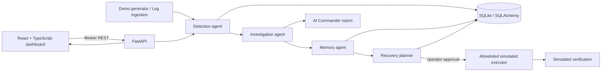
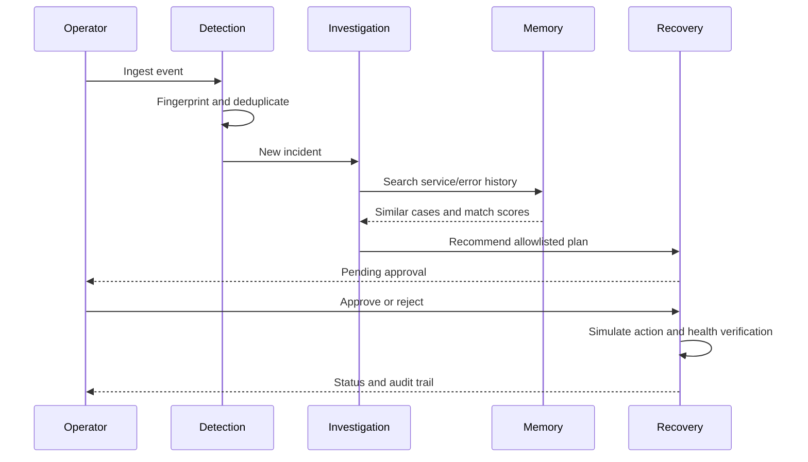

# REACT AI

REACT AI is a local incident command application. It ingests log events, fingerprints duplicate events, stores incidents in SQLite, produces evidence-backed rule-based investigation hypotheses, retrieves comparable incident history, proposes recovery, and records human-approved simulated recovery with a simulated verification result. It does not run shell commands or change real infrastructure.

## Requirements

- Python 3.11 or newer
- Node.js 20 or newer
- (Optional) Docker Desktop

No external AI key is required. The investigator uses transparent rules and labels its confidence. This application is a hackathon demo, not a production monitoring or remediation service.

## Windows setup and run

From PowerShell in this folder:

```powershell
Set-ExecutionPolicy -Scope Process Bypass
.\setup-windows.ps1
```

Start the API in terminal 1:

```powershell
cd backend
.\.venv\Scripts\Activate.ps1
uvicorn app.main:app --reload --port 8000
```

Start the React UI in terminal 2:

```powershell
cd frontend
npm run dev
```

Open http://localhost:5173. Initial local login is `admin` / `reactai-demo`. Set `DEMO_PASSWORD` and `APP_SECRET` before sharing or deploying. API docs are at http://localhost:8000/docs. Persistent SQLite database is `backend/react_ai.db`.

If Python's Microsoft Store alias intercepts `python`, install the official Python distribution with the `py` launcher, then use the virtual environment executable as in the commands above.

## macOS / Linux

```bash
python3 -m venv backend/.venv
source backend/.venv/bin/activate
pip install -r backend/requirements.txt
uvicorn app.main:app --app-dir backend --reload --port 8000
```

In another terminal:

```bash
cd frontend
npm install
npm run dev
```

On macOS/Linux set `DEMO_PASSWORD` and `APP_SECRET` in the shell before starting the backend. To use a custom API address set `VITE_API_URL` before building the UI.

## Docker

```bash
docker compose up --build
```

Open http://localhost:8000 (the API also serves `/docs`). The named `react-data` volume persists SQLite. Docker's frontend is served by the same API container. For a public or multi-user deployment, use a unique secret, replace the default password, configure TLS and trusted origins, and use PostgreSQL plus an external identity provider.

## Simulate a failure and show the agents

1. Sign in, then click **Run demo scenario**. The backend selects from five built-in patterns: HTTP 500, exhausted database connections, high CPU, memory exhaustion, and service unavailability. It labels each event `simulated`.
2. Open **Incidents** and select the new incident. Duplicate fingerprints group repeat events and increment the occurrence count.
3. The incident report shows a probable cause, evidence, confidence, recommended action, similar cases, and agent run records. Click **Re-run investigation** to run investigation and memory lookup again.
4. In **Recovery**, open the incident plan. It begins `PENDING_APPROVAL`. Approve or reject it explicitly. Only an approved plan can be executed.
5. Click **Execute simulated recovery** after approval. The app updates the incident to resolved and records a simulated health verification. Check **Audit Logs** for the approval and execution entries.
6. **Live Logs** shows event source. **Settings** can sample host CPU and memory via psutil when supported. Host samples and demo samples are distinguished in the API data.

To run one event without the UI, log in at `/api/auth/login` then call `POST /api/demo/generate?count=1` with the bearer token. For manual ingestion, use `POST /api/logs/ingest` with `{ "service":"checkout", "level":"ERROR", "message":"HTTP 500: handler exception" }`.

## API

- `GET /api/health` (public)
- `POST /api/auth/login` (public)
- `GET /api/dashboard/summary`
- `GET /api/incidents`, `GET /api/incidents/{id}`
- `POST /api/incidents/{id}/resolve`
- `POST /api/logs/ingest`, `GET /api/logs`
- `POST /api/demo/generate?count=1..5`
- `POST /api/agents/investigate/{id}`, `GET /api/agents/status`
- `POST /api/recovery/approve/{id}`, `/reject/{id}`, `/execute/{id}`
- `GET /api/audit`, `GET /api/metrics`

All routes except health and login require a bearer token. A single bootstrap administrator is initialized on first start. Recovery endpoints enforce explicit approval and an allowlist. SQLite can be replaced with PostgreSQL by setting `DATABASE_URL` to a SQLAlchemy PostgreSQL URL and installing a PostgreSQL driver.

## Tests

```bash
pip install -r backend/requirements.txt
pip install httpx
python -m unittest discover -s backend/tests -v
```

The workflow tests use an isolated temporary SQLite database and exercise API authentication, deduplication, investigation, approval gating, execution, verification, and audit records.

## Project layout

```text
react-ai/
├── backend/app/main.py       FastAPI API, SQLAlchemy models, agents and workflows
├── backend/tests/            End-to-end API workflow tests
├── frontend/src/ui.tsx       React dashboard and functional pages
├── frontend/src/style.css    Responsive dark UI
├── Dockerfile
├── docker-compose.yml
├── setup-windows.ps1
└── README.md
```

## Hackathon presentation notes

### Problem

Small engineering teams receive noisy logs across services and must manually correlate events, identify likely causes, remember prior fixes, and coordinate safe recovery. Context switching and duplicated alerts delay response.

### Proposed solution

REACT AI turns incoming log events into persistent, deduplicated incidents. Five modular agents perform detection, investigation, memory search, recovery planning, and final coordination. Operators get an evidence-backed report and must approve any recovery action.

### Key innovations

- Duplicate fingerprints group repeated log patterns into one active incident.
- Rule-based diagnosis includes evidence and a confidence score; uncertain causes stay explicitly uncertain.
- Similar local incidents are available as memory matches.
- Recovery is allowlisted, approval-gated, simulated, and audited.
- Demo event generation and optional host resource sampling are visibly distinguished.

### Architecture diagram



### Agent workflow



### Database architecture

`users` owns operator credentials and role; `incidents` stores fingerprint, severity, status and investigation; `logs` links raw events to incidents; `agent_runs` records each agent report; `recovery_plans` holds the allowlisted action and approval state; `audit_events` captures decisions and execution; `metrics` stores timestamped resource samples. SQLite is the local default; SQLAlchemy supports configuring a PostgreSQL URL.

### Technical implementation

FastAPI validates requests and serves OpenAPI documentation. SQLAlchemy persists state. Passwords are PBKDF2 hashed; login creates a signed expiring bearer token. The React/Vite app polls for fresh dashboard data, uses Recharts for resource trends, and calls the same API for every action. Five agent roles are represented by modular backend functions and persisted run records.

### Verification results

Workflow tests are included for login, duplicate grouping, investigation, approval gating, simulated execution/verification, and audit persistence. Run them with the command above. Host metric sampling depends on operating-system support for psutil.

### Limitations and future scope

This local demo uses deterministic keyword rules rather than a learned model, has one bootstrap admin account, polls rather than using WebSockets, and uses a simple service/error history similarity heuristic. It does not connect to production infrastructure or execute real remediation. Next steps could add SSO and fine-grained roles, PostgreSQL migrations, richer similarity search, OpenTelemetry ingestion, notification integrations, and a separately sandboxed real-environment adapter with explicit approvals.

### Five-minute demo script

1. **0:00–0:40 — Context:** explain repeated incidents and the goal of evidence-backed, human-controlled response.
2. **0:40–1:20 — Dashboard:** show health, resource charts, agent readiness, and the demo-mode label.
3. **1:20–2:10 — Detection:** generate scenarios; open the incident and show severity, event source, and duplicate grouping.
4. **2:10–3:00 — Investigation and memory:** inspect probable cause, supporting evidence, confidence, recommendation, agent runs, and history matches.
5. **3:00–4:15 — Guarded recovery:** show pending plan; try execute before approval to demonstrate the guard; approve then execute the simulated action.
6. **4:15–5:00 — Verification and audit:** show resolved simulated status, audit entries, and explain the no-production-side-effects boundary.
